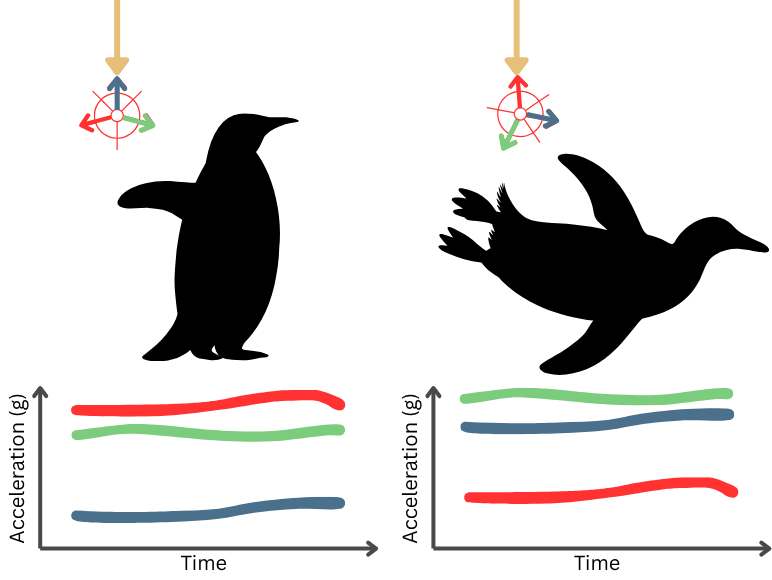

# How accelerometers measure behaviour
Accelerometers are devices that measure instantaneous accelerations, including gravity, and store this as a time-series record. By inspecting the recorded accelerations, the orientation and movement of the device can be reconstructed and understood. As each unique pattern of movement will result in unique acceleration records, the specific initial movements can be determined. Accelerometers in sports-watches enable the counting of steps and tracking of exercise effort. The same concept applies to animal tracking.

Accelerometer-based animal behaviour classification was first trialled with Adelia penguins in the early 2000s (Yoda et al., 2021) where the changes in measurement of gravity enabled the body orientation of the penguins to be differentiated and therefore land (upright) vs water (horizontal) behaviours differentiated (Figure 1). 

  

<em>Fig 1: The change in accelerometer axis measuring dominant "gravity" acceleration (direction denoted by yellow arrow), can be used to infer the body posture and therefore the behaviour of the penguin.</em>

Since then, accelerometers have been used on hundreds of species to understand increasingly fine-scale behaviours. Some behaviours (e.g., the postural change in the penguin example above) can be differentiated with simple threshold rules (e.g., if Y > Z, then horizontal, else, vertical) but more complex behavioural states require more complex rules based on multiple variables --- not all of which are readily interpretable to humans. Additionally, as devices are often sampling for weeks or months at a time, there is far too much data to be assessed by a human within the timeframes of most ecological projects. Instead, supervised machine learning (ML) is often used to automate the classification process.

