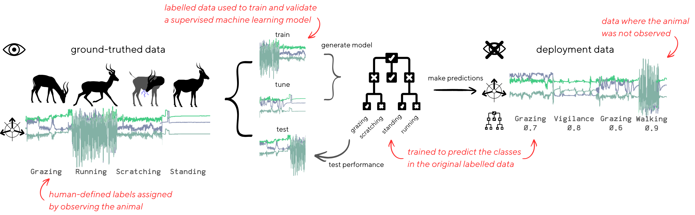
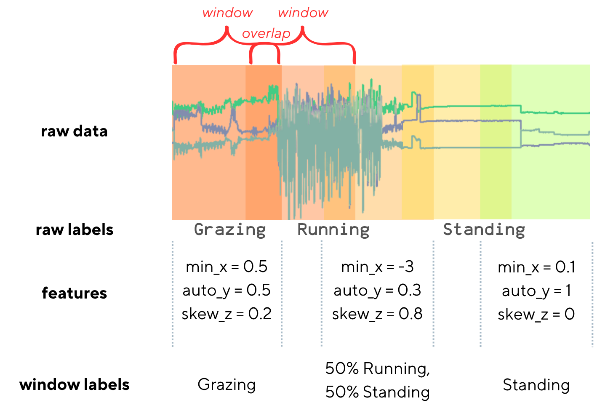

# Supervised machine learning: an introduction to basic terms and concepts
ML is when the algorithm learns the classification rules directly from the data (rather than having been explicitly defined by humans, as in the threshold example). In this case, algorithms are provided with example data where human-defined labels have been applied to a small subset of the full data. This *ground-truthed* data is used to develop the model. Model development constitutes *tuning*, *training*, and *testing* stages (Figure 2). 

Training is when labelled data is provided to the model in order to learn the rules of categorisation. Tuning, also known as hyperparameter optimisation, is when the optimal design of the ML model is decided through trial-and-error. Hyperparameters are variables that determine the ML model's learning ability (for example, the number of branches in the decision tree, or number of times the model is allowed to sample each datapoint) but aren't determined from the labelled data, and are instead set externally. The best parameters are decided by iteratively trialling possible parameter combinations and testing the performance of the model after each combiantion. The parameters that result in the highest performance are considered optimal. **aniML** uses Bayesian Optimisation to search through possible parameter combinations and efficiently converge upon local optima. When the hyperparameters have been tuned, a final model is trained and tested. Testing is when the trained model makes predictions onto some other held-out portion of labelled data not included in the training process (neither training nor tuning), and the predicted categories are compared to the true behavioural classes. The more the predicted classes align with the true classes, the better the model is said to be. 

Finally, this trained and validated model is applied to the unlabelled *deployment data* where the true classes are not known. These predictions are used to understand the ecology and behaviour of the animal.

  

<em>Fig 2: Labelled data is partitioned into training, tuning, and testing portions to build and validate a ML classification model. Finally, this model is applied to the unlabelled and unknown data from deployment.</em>

Some model types -- typically deep learning models -- can input and predict on raw accelerometer data, but the models encountered in **aniML** are not this kind. **aniML** focuses on classical, statistical models which cannot deal with raw data. Instead, these models interpret data from *features* (Figure 3). Features are essentially just summarisations of the data contained within each *window*, where windows are consecutive segments of data. Windows partition continuous time-series data into discreet units. These windows can be *overlapping* (contain some of the same data in neighbouring windows) or *non-overlapping* (containing no shared data). 

  

<em>Fig 3: Anatomy of a feature window.</em>

The features a model recieves determine the quality of the subsequent classification. Poor features that inadequately capture the difference between classes, or are superfulous and contain little differentiating infomation, damage the performance of the model. *Feature engineering* and *feature selection* are both concerned with creating and choosing optimal features, respectively. Similarly, the window length interacts with the feature quality. Long windows risk containing multiple different behaviours (sometimes knonw as *contamination*) while short windows risk not capturing enough of a behaviour to be distinguishable (i.e., a window containing a single step may or may not be identifiable as "walking", which is defined by a repeating pattern of steps).
