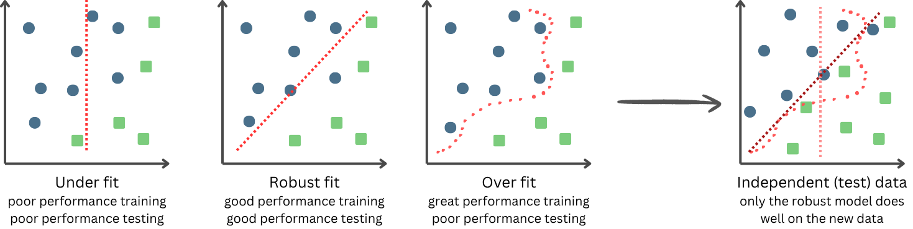
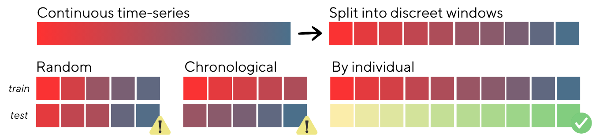

# Model testing, overfitting detection, and data independence
Performance testing is one of the most important and yet most easily misunderstood steps in the ML workflow. An untested model is an unknown model, and we can only know about our model what we are capable of testing for, in the way that we tested it. Our goal is to approximate the true performance of the model on new data by providing test data that is equally as *independent* from the training data as the target deployment data will be. We want to avoid overestimating or otherwise misrepreseting the performance of the model as that will prevent us from understanding how it is actually performing on the independent data.

One of the key goals of model testing is to detect the *fit* (Figure 4). Underfitting is when the model has insufficiently learnt the classifications and separates them poorly. Overfitting is when a model memorises the exact labelled training data it had access to, rather than learning generalised and generalisable rules about the data. While an overfit model will perform well on the training data, it will have poor performance on any data that deviates from this training data (i.e., the deployment data). The goal is to train a model to the point that it can generally classify the trained classes without memorisation.

  

<em>Fig 4: Under and overfitting.</em>

While in much of ecology, independence between the training and testing sets can be achieved with randomisation, this is not the case for *timeseries data*. Because each time window is related to the consecutive windows, randomly dividing these windows between the training and test sets makes the test set non-independent of the training data, and is likely to mask overfitting to the training data. Instead, to achieve independent test sets, the test set should be drawn chronologically separate from the training set, or from a different individual (Figure 5). 

  

<em>Fig 5: Stratifying time-series data for test set independence.</em>

For further information and practical guidelines for model testing see complete guide: [Wilson et al., 2025](https://besjournals.onlinelibrary.wiley.com/doi/10.1111/1365-2656.70054).
