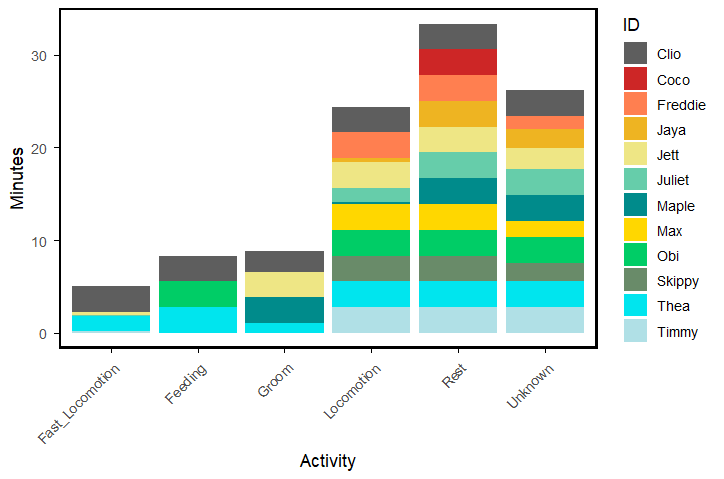
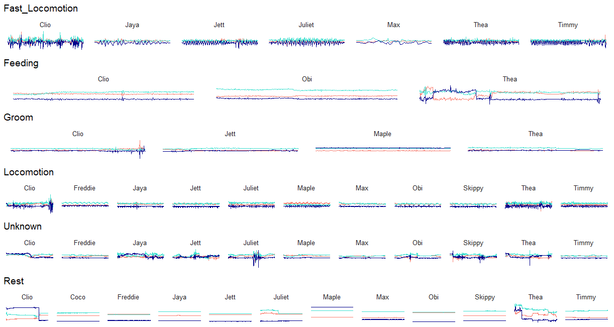
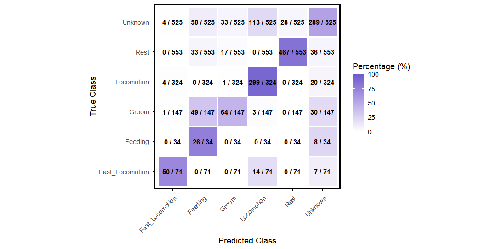
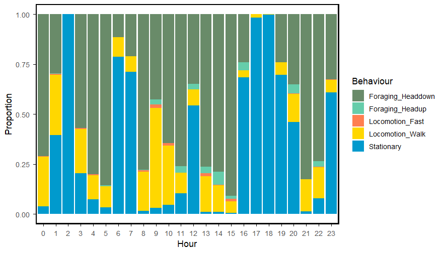
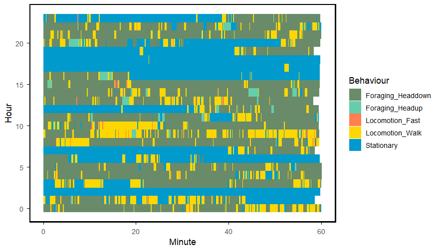

# Cat Worked Example

In this worked example, the data has a few inconsistencies and limitations and therefore requires a more customised approach of the aniML package. Data will be prepared, a model tuned and trained, and predictions made on the deployment data from a single day from a single cat.

## Dataset details
Data was collected with a chest-mounted Axivity AX3 accelerometer. Data was collected by Nicole Galea and Oakleigh Wilson. Training data was annotated by Amelia Nelson and Oakleigh Wilson.

## Behavioural classification workthrough
Data are expected to be in format of 1 row per time observation, with columns ID, Time, Activity, and the triaxial accelerometer readings - X, Y, and Z. In this example, the data is already in the appropriate format.

### Exploration

<p align="center">
  
</p>
<p align="center"><em>Fig 1: Examples from each behavioural class (row) from each individual (column) in the labelled data. Use this plot as a QA to check whether the behaviours confirm to expectation.</em></p>

The variable relative positions of the axes during active behaviours such as fast locomotion indicate that devices may have been oriented differently during positioning on the animals. Specifically, Clio and Thea appeae to be oriented differently. In that case, rotation of the devices to a stable orientation will be required.

<p align="center">
  
</p>
<p align="center"><em>Fig 2: Represented volume of each bhevaioural class where bar is behaviour and colour is individual.</em></p>

The fast locomotion behaviour is a target class but is underrepresented. This can be a target for augmentation.

### Preprocessing

The first stage is to prepare the accelerometer data for processing. Outliers, machine noise, and inonsistencies in collaring protocol (e.g., orientation of the devices) will make the process harder. Therefore, the first step is to standardise where possible.

In this case, units are all in the same scale, but will require rotation and filtering.

Run the preprocessing function with the selected processing steps. Where no variables are specified, a default processing will be applied. In this case, the individuals Juliet and Jett were selected as the reference individual to which the other individuals should be rotated.

```
processed <- preprocessing(data, sample_rate, filter = filtering, rotate = rotating, 
                           rotation_ref_data = data[data$ID %in% c("Juliet", "Jett")])
```

<p align="center">
  
</p>
<p align="center"><em>Fig 3: Examples from each behavioural class (row) from each individual (column) in the labelled data after being rotated. This confirms that all devices are now in the same orientation.</em></p>

### Augmentation
If there are one or more ecologically important significantly underrepresented minority classes, these can be augmented to increase prevalance in the dataset. In this case, Fast_Locomotion is underrepresented and can be increased with augmentation.

```
boosted <- boost_minority_classes(processed, features, target_classes = c("Fast_Locomotion"))
```

**NOTE!!! ADD THIS WHEN COMPLETED**

### Tuning, testing, and training
With the labelled data prepared, a model can now be tuned and cross-validated to obtain performance estimates.

If no variables are specified, the model will default to a Random Forest and will search a default hyperparameter space, optimising for the macro-average F1. In this case, we only care about a few specific behaviours, so these have been defined as the target behaviours and the model will optimise for them specifically. 

```
tuning_metrics <- tune_model(data = boosted,
                             target_classes = c("Fast_Locomotion", "Locomotion", "Rest"),
                             optimisation_macro = "Target-Macro-Average", 
                             optimisation_metric = "F1"
)

```
Output from this function include confusion matrices, optimal parameters, and performance metrics for each of the folds. 

In this case, the performance of the impala model is around 0.82 macro-average F1 for the target classes but about 0.64 across all classes.

<p align="center">
  
</p>
<p align="center"><em>Fig 4: Example confusion matrix from one fold of the optimisation of the cat model. True class (as determined from the videos) are rows and predicted class (predicted by the model) are the columns. Values represent the number of true classes predicted per predicted class out of all true counts in that class. Colours represent percentage of each true class.</em></p>


PAUSE HERE!!!!!!


If performance is unexpectedly good, poor, or confusing, that may indicate inconsistencies in the labelled data.

If proceeding, generate the final model.

```
parameters <- tuning_metrics$parameters
chosen_parameters <- list(mtry = mean(parameters$mtry), num_trees = mean(parameters$num_trees), max_depth = mean(parameters$max_depth)) 

final_model <- generate_final_model(features, model = 'RF', chosen_parameters)
```

### Make predcitions
Finally, to apply this model to the unlabelled data, the unlabelled data must be preprocessed in the same way as the training data and then passed into the prediction function. If no variables are defined, the data will be processed in a default way. 

```
unlabelled_data <- fread("Guides/WorkedExample/Cat/GaleaCat_unlabelled_example.csv")
proc_unlabelled_data <- preprocessing(unlabelled_data, sample_rate, filter = filtering, rotate = rotating, 
                           rotation_ref_data = data[data$ID %in% c("Juliet", "Jett")])

final_output <- generate_predictions(proc_unlabelled_data,
                                     sample_rate, overlap_percent, window_length,
                                     final_model, 
                                     model_type = "RF")

```
These are now the final results.

### Ecological analysis
A few basic graphs can be generated.

<p align="center">
  
</p>
<p align="center"><em>Fig 3: Behavioural budget for one day of one impala showing the proportion of each behaviour per hour.</em></p>

<p align="center">
  
</p>
<p align="center"><em>Fig 4: Behavioural sequence of one day of one impala, represented as behaviour per second across each hour (row).</em></p>
