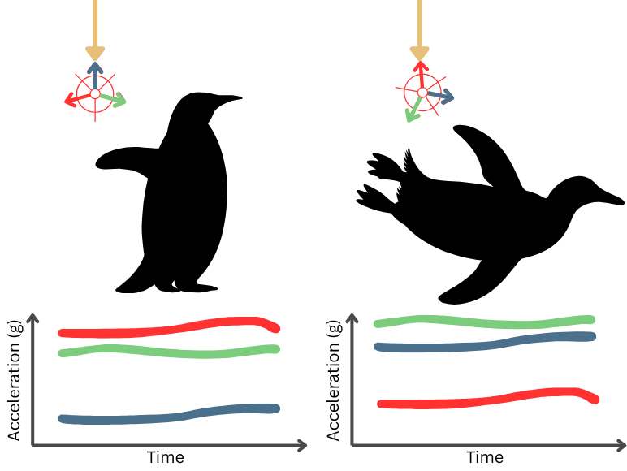
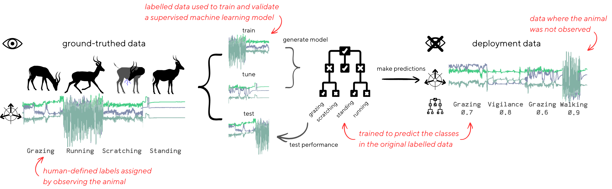
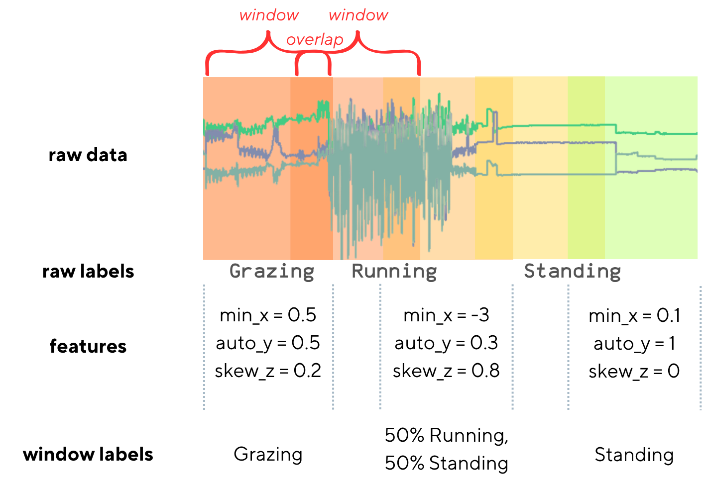
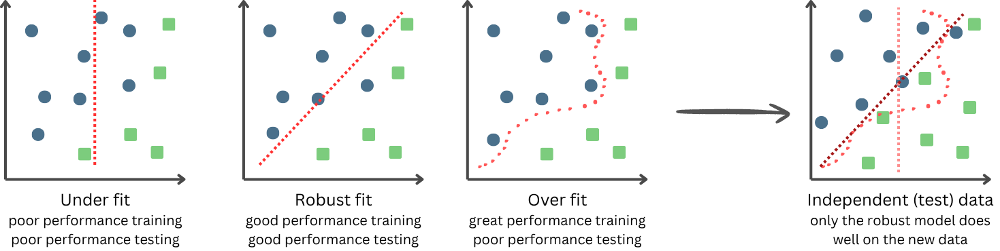
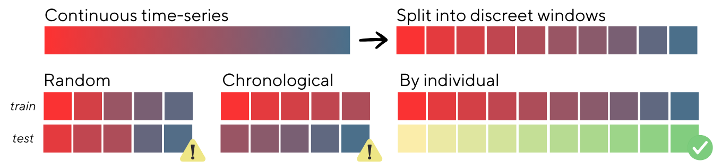

# Introduction

## How accelerometers measure behaviour
Accelerometers are devices that measure instantaneous accelerations, including gravity, and store this as a time-series record. By inspecting the recorded accelerations, the orientation and movement of the device can be reconstructed and understood. As each unique pattern of movement will result in unique acceleration records, the specific initial movements can be determined. Accelerometers in sports-watches enable the counting of steps and tracking of exercise effort. The same concept applies to animal tracking.

Accelerometer-based animal behaviour classification was first trialled with Adelia penguins in the early 2000s (Yoda et al., 2021) where the changes in measurement of gravity enabled the body orientation of the penguins to be differentiated and therefore land (upright) vs water (horizontal) behaviours differentiated (Figure 1). 

  

<em>Fig 1: The change in accelerometer axis measuring dominant "gravity" acceleration (direction denoted by yellow arrow), can be used to infer the body posture and therefore the behaviour of the penguin.</em>

Since then, accelerometers have been used on hundreds of species to understand increasingly fine-scale behaviours. Some behaviours (e.g., the postural change in the penguin example above) can be differentiated with simple threshold rules (e.g., if Y > Z, then horizontal, else, vertical) but more complex behavioural states require more complex rules based on multiple variables --- not all of which are readily interpretable to humans. Additionally, as devices are often sampling for weeks or months at a time, there is far too much data to be assessed by a human within the timeframes of most ecological projects. Instead, supervised machine learning (ML) is often used to automate the classification process.

## Supervised machine learning: an introduction to basic terms and concepts
ML is when the algorithm learns the classification rules directly from the data (rather than having been explicitly defined by humans, as in the threshold example). In this case, algorithms are provided with example data where human-defined labels have been applied to a small subset of the full data. This *ground-truthed* data is used to develop the model. Model development constitutes *tuning*, *training*, and *testing* stages (Figure 2). 

Training is when labelled data is provided to the model in order to learn the rules of categorisation. Tuning, also known as hyperparameter optimisation, is when the optimal design of the ML model is decided through trial-and-error. Hyperparameters are variables that determine the ML model's learning ability (for example, the number of branches in the decision tree, or number of times the model is allowed to sample each datapoint) but aren't determined from the labelled data, and are instead set externally. The best parameters are decided by iteratively trialling possible parameter combinations and testing the performance of the model after each combiantion. The parameters that result in the highest performance are considered optimal. **aniML** uses Bayesian Optimisation to search through possible parameter combinations and efficiently converge upon local optima. When the hyperparameters have been tuned, a final model is trained and tested. Testing is when the trained model makes predictions onto some other held-out portion of labelled data not included in the training process (neither training nor tuning), and the predicted categories are compared to the true behavioural classes. The more the predicted classes align with the true classes, the better the model is said to be. 

Finally, this trained and validated model is applied to the unlabelled *deployment data* where the true classes are not known. These predictions are used to understand the ecology and behaviour of the animal.

  

<em>Fig 2: Labelled data is partitioned into training, tuning, and testing portions to build and validate a ML classification model. Finally, this model is applied to the unlabelled and unknown data from deployment.</em>

Some model types -- typically deep learning models -- can input and predict on raw accelerometer data, but the models encountered in **aniML** are not this kind. **aniML** focuses on classical, statistical models which cannot deal with raw data. Instead, these models interpret data from *features* (Figure 3). Features are essentially just summarisations of the data contained within each *window*, where windows are consecutive segments of data. Windows partition continuous time-series data into discreet units. These windows can be *overlapping* (contain some of the same data in neighbouring windows) or *non-overlapping* (containing no shared data). 

  

<em>Fig 3: Anatomy of a feature window.</em>

The features a model recieves determine the quality of the subsequent classification. Poor features that inadequately capture the difference between classes, or are superfulous and contain little differentiating infomation, damage the performance of the model. *Feature engineering* and *feature selection* are both concerned with creating and choosing optimal features, respectively. Similarly, the window length interacts with the feature quality. Long windows risk containing multiple different behaviours (sometimes knonw as *contamination*) while short windows risk not capturing enough of a behaviour to be distinguishable (i.e., a window containing a single step may or may not be identifiable as "walking", which is defined by a repeating pattern of steps).

## Model testing, overfitting detection, and data independence
Performance testing is one of the most important and yet most easily misunderstood steps in the ML workflow. An untested model is an unknown model, and we can only know about our model what we are capable of testing for, in the way that we tested it. Our goal is to approximate the true performance of the model on new data by providing test data that is equally as *independent* from the training data as the target deployment data will be. We want to avoid overestimating or otherwise misrepreseting the performance of the model as that will prevent us from understanding how it is actually performing on the independent data.

One of the key goals of model testing is to detect the *fit* (Figure 4). Underfitting is when the model has insufficiently learnt the classifications and separates them poorly. Overfitting is when a model memorises the exact labelled training data it had access to, rather than learning generalised and generalisable rules about the data. While an overfit model will perform well on the training data, it will have poor performance on any data that deviates from this training data (i.e., the deployment data). The goal is to train a model to the point that it can generally classify the trained classes without memorisation.

  

<em>Fig 4: Under and overfitting.</em>

While in much of ecology, independence between the training and testing sets can be achieved with randomisation, this is not the case for *timeseries data*. Because each time window is related to the consecutive windows, randomly dividing these windows between the training and test sets makes the test set non-independent of the training data, and is likely to mask overfitting to the training data. Instead, to achieve independent test sets, the test set should be drawn chronologically separate from the training set, or from a different individual (Figure 5). 

  

<em>Fig 5: Stratifying time-series data for test set independence.</em>

For further information and practical guidelines for model testing see complete guide: [Wilson et al., 2025](https://besjournals.onlinelibrary.wiley.com/doi/10.1111/1365-2656.70054).

## Pre- and post-processing
The development of the ML model itself is only one stage in the overall analysis pipeline. **aniML** has built in additional stages of the ML pipleine including *pre-processing* (preparing the data to be fed to the ML model) and *post-processing* corrections and improvements after prediction has been made.

To be continued...

